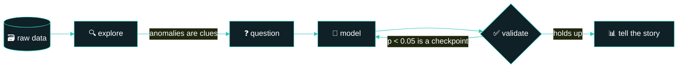
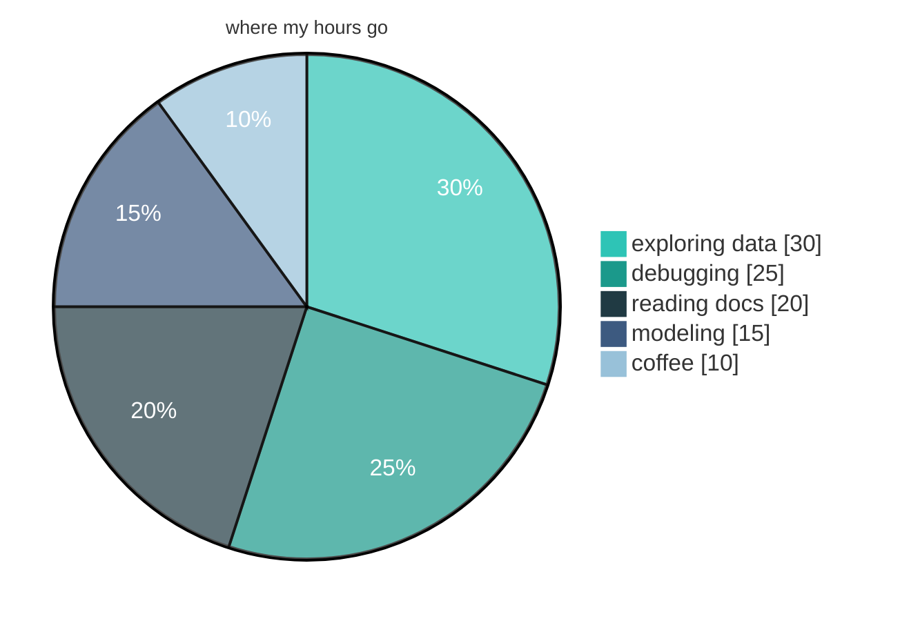

<div align="center">


<br/>


</div>

<br/>

> [!TIP]
> **🟢 Open to work:** internships & junior roles in **data science · ML · data engineering**.
> Let's talk → [LinkedIn](https://www.linkedin.com/in/amjad-a-076262297) · [Email](mailto:amjadazward693@gmail.com)

<br/>


<div align="center">
<table>
<tr>
<td><a href="https://github.com/AmjadAzward"></a></td>
<td><a href="https://github.com/AmjadAzward"></a></td>
</tr>
<tr>
<td><a href="https://github.com/AmjadAzward"></a></td>
<td><a href="https://github.com/AmjadAzward"></a></td>
</tr>
</table>
</div>

<br/>


<div align="center">

</div>

<br/>




<br/>


<div align="center">

</div>

<br/>


<table>
<tr>
<td width="50%" valign="top">

```diff
+ AI agent design & orchestration
+ two-way ANOVA in R & SAS
  (correction factor, LSM)
+ semantic network for a
  hospital knowledge domain
+ event design @ IEEE SB NIBM
! next: coursework → real,
  defensible data pipelines
```

</td>
<td width="50%" valign="top">



</td>
</tr>
</table>

<br/>


<div align="center">

<br/><br/>

</div>

<details>
<summary><b>🗓️ open the 6-month heatmap (with the actual numbers)</b></summary>
<br/>
<div align="center"></div>
</details>

<details>
<summary><b>🎲 click for a random sample of facts about me</b></summary>

<br/>

```python
>>> random.sample(facts, 4)
[
  "I believe outliers usually tell the best part of the story",
  "a well-labelled boxplot is my love language",
  "I run R and SAS side by side just to see who disagrees",
  "I design posters by day and debug pipelines by night"
]
```

</details>

<br/>


<div align="center">

<a href="https://www.linkedin.com/in/amjad-a-076262297"></a>
<a href="mailto:amjadazward693@gmail.com"></a>
<a href="https://x.com/AmjadAzward"></a>
<br/>
<a href="https://www.kaggle.com/amjadazward"></a>
<a href="https://leetcode.com/amjadazward"></a>
<a href="https://www.hackerrank.com/profile/SL_Spark"></a>
<a href="https://www.credly.com/users/mohamed-amjad.1b89812f"></a>
<a href="https://learn.microsoft.com/en-us/users/amjadazward-4476/"></a>

<br/><br/>

<sub><i>"All models are wrong, but some are useful." — George Box</i></sub><br/>
<sub>Drawn in my own teal design system · numbers redrawn every night by a GitHub Action</sub>

</div>
