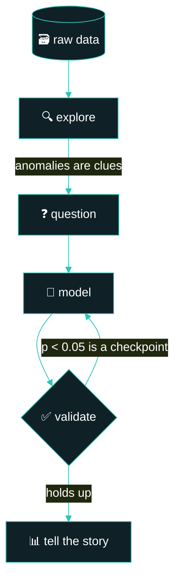
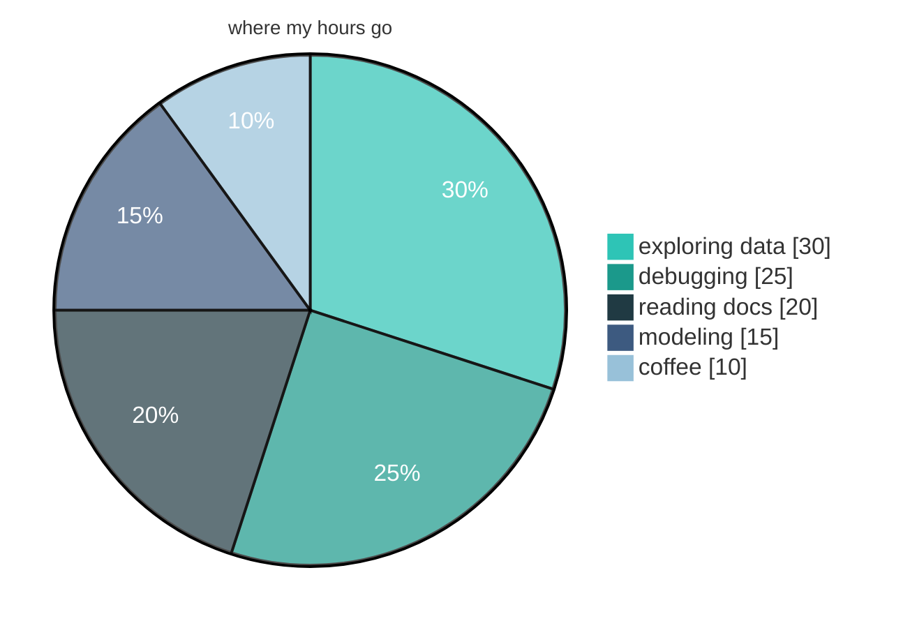

<div align="center">


<p>


</p>

</div>

```python
In [1]: import amjad

In [2]: amjad.whoami()
Out[2]: "data science undergrad @ NIBM"

In [3]: amjad.believes_in()
Out[3]: ["outliers", "boxplots", "defensible models"]

In [4]: amjad.is_open_to_work()
Out[4]: True   # ← you are here
```

> [!NOTE]
> I turn **messy data** into **models I can defend** and **charts that argue a point**.
> Outliers are my favourite part of any dataset. Right now I'm deep into **AI agents** and designing events with the **IEEE SB NIBM** Design Team.

> [!TIP]
> **🟢 Open to work:** internships & junior roles in **data science · ML · data engineering**.
> Let's talk → [LinkedIn](https://www.linkedin.com/in/amjad-a-076262297) · [Email](mailto:amjadazward693@gmail.com)

<br/>


| stat | value |
|---|---|
| **count** | 1 (limited edition) |
| **mean** | 1 coffee too many |
| **std** | high, especially near deadlines |
| **min** | 0 patience for dirty data |
| **25%** | exploring data |
| **50%** | debugging |
| **max** | curiosity (clipped at 1.0) |
| **dtype** | perpetually learning |

<br/>


| 🔬 Experiment | 🧫 Hypothesis | 📌 Status |
|---|---|---|
| 🤖 **AI Agent Lab** | Agents can be designed, orchestrated and trusted | `running` |
| 📐 **ANOVA in R & SAS** | Two software packages should agree. Do they? | `results in` |
| 🕸️ **Semantic Network** | A hospital's knowledge fits in a graph | `modeled` |
| 🎨 **IEEE SB Design** | Good design makes events remembered | `shipping` |

<br/>


<sub>what drives my work, according to a very biased model</sub>

```text
curiosity           ████████████████████ 0.24
statistics          █████████████████░░░ 0.21
python & r          ███████████████░░░░░ 0.18
data engineering    ███████████░░░░░░░░░ 0.14
visual storytelling ██████████░░░░░░░░░░ 0.12
ai agents           █████████░░░░░░░░░░░ 0.11
                                  total 1.00
```

<br/>




<br/>


```text
H0: this README is just another
    profile page.
H1: this one has something to say.

α = 0.05
p = 0.04   → reject H0 ✔
```

<br/>


<div align="center">


</div>

<br/>


```diff
+ AI agent design & orchestration
+ two-way ANOVA in R & SAS
  (correction factor, LSM)
+ semantic network for a
  hospital knowledge domain
+ event design @ IEEE SB NIBM
! next: coursework → real,
  defensible data pipelines
```



<br/>


### 🧮 `stats.summary()` — the overview

<div align="center">


</div>

### 🔥 `streak.plot()` — consistency

<div align="center">


</div>

### 📉 `ts.plot()` — commit time series

<div align="center">


</div>

<details>
<summary><b>🗓️ <code>sns.heatmap()</code> — open the contribution heatmap</b></summary>
<br/>
<div align="center"></div>
</details>

<br/>

<details>
<summary><b>🎲 click for a random sample of facts about me</b></summary>

<br/>

```python
>>> random.sample(facts, 4)
[
  "I believe outliers usually tell
   the best part of the story",
  "a well-labelled boxplot is
   my love language",
  "I run R and SAS side by side
   just to see who disagrees",
  "I design posters by day and
   debug pipelines by night"
]
```

</details>

<details>
<summary><b>🚨 outlier log (do not open)</b></summary>

<br/>

```text
outlier #1: stayed up to fix one
            misplaced decimal.
outlier #2: the decimal was fine.
            the bug was me.
```

</details>

<br/>


```python
>>> amjad.reply_time()
"fast (coffee permitting)"

>>> amjad.send(you, "let's build something defensible")
```

<div align="center">

<a href="https://www.linkedin.com/in/amjad-a-076262297"></a>
<a href="mailto:amjadazward693@gmail.com"></a>
<a href="https://x.com/AmjadAzward"></a>
<a href="https://www.kaggle.com/amjadazward"></a>
<a href="https://leetcode.com/amjadazward"></a>
<a href="https://www.hackerrank.com/profile/SL_Spark"></a>
<a href="https://www.credly.com/users/amjadazward"></a>
<a href="https://learn.microsoft.com/en-us/users/amjadazward/"></a>

</div>
