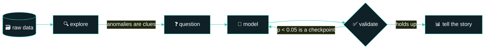
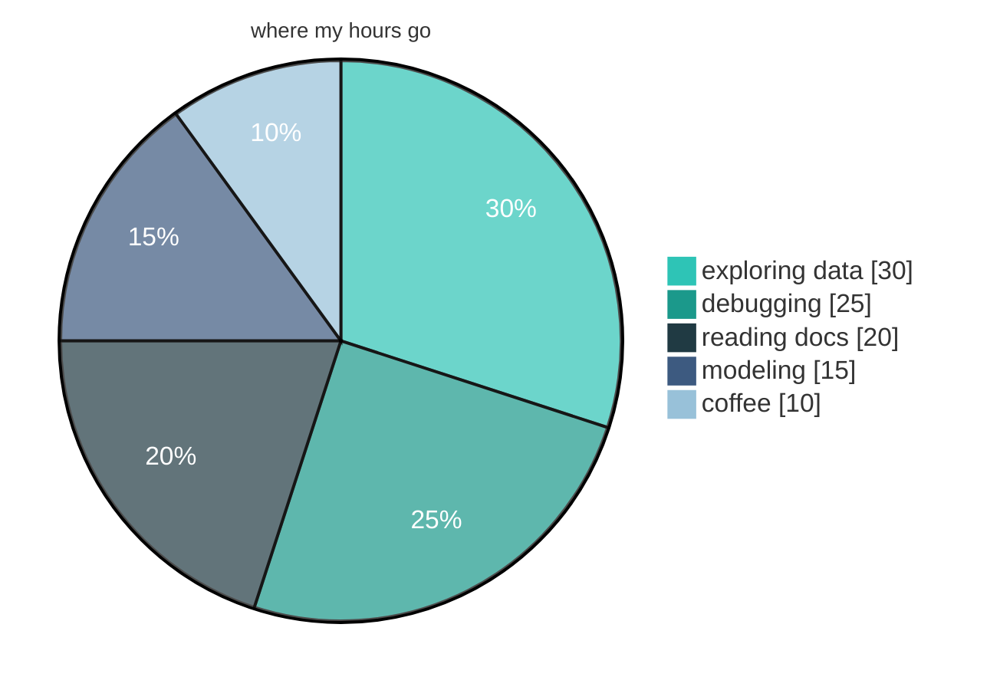

<div align="center">


<br/>


</div>

<br/>

<table>
<tr>
<td width="55%" valign="top">


**Data Science undergrad @ NIBM** 🇱🇰<br/>
<sub><i>I live for the moment a messy dataset finally clicks.</i></sub>

<br/>

<b>⚙️ how I work</b>

🗃️ &nbsp;**pull** the raw, messy data<br/>
🔍 &nbsp;**interrogate** every outlier<br/>
🧠 &nbsp;**build** models I can defend<br/>
📊 &nbsp;**plot** charts that argue a point

<br/>

<b>📡 right now</b>

🤖 &nbsp;deep into **AI agent architectures**<br/>
🎨 &nbsp;designing events with the **IEEE SB NIBM** Design Team

</td>
<td width="45%" valign="top">

```python
>>> amjad.status()

open_to_work  = True
focus         = ["statistics",
                 "machine learning",
                 "data engineering"]
exploring     = "AI agents"
coffee_level  = "dangerously high"
dtype         = "perpetually learning"
```

</td>
</tr>
</table>

> [!TIP]
> **🟢 Open to work:** internships & junior roles in **data science · ML · data engineering**.
> Let's talk → [LinkedIn](https://www.linkedin.com/in/amjad-a-076262297) · [Email](mailto:amjadazward693@gmail.com)

<br/>

## 🧬 `model.feature_importances_`
<sub>what actually drives my work, according to a very biased model</sub>

```text
curiosity             ████████████████████████  0.24
statistics            █████████████████████░░░  0.21
python & r            ██████████████████░░░░░░  0.18
data engineering      ██████████████░░░░░░░░░░  0.14
visual storytelling   ████████████░░░░░░░░░░░░  0.12
ai agents             ███████████░░░░░░░░░░░░░  0.11
                                          total 1.00
```

<br/>

## 🔁 `pipeline.run()`
<sub>how I approach every problem</sub>



<br/>

## 🛠️ `df.stack()`

<div align="center">


<br/>

<br/>

<br/>


<br/><br/>


<br/>


</div>

<br/>

<table>
<tr>
<td width="50%" valign="top">

## ⏳ `git log --recent`

```diff
+ AI agent design & orchestration
+ two-way ANOVA in R & SAS
  (correction factor, LSM)
+ semantic network for a
  hospital knowledge domain
+ event design @ IEEE SB NIBM
! next: coursework → real,
  defensible data pipelines
```

</td>
<td width="50%" valign="top">

## 🥧 `time.value_counts()`



</td>
</tr>
</table>

<br/>

## 📈 `plt.show()`

<div align="center">


<br/><br/>


</div>

<br/>

<details>
<summary><b>🎲 click for a random sample of facts about me</b></summary>

<br/>

```python
>>> random.sample(facts, 4)
[
  "I believe outliers usually tell the best part of the story",
  "a well-labelled boxplot is my love language",
  "I run R and SAS side by side just to see who disagrees",
  "I design posters by day and debug pipelines by night"
]
```

</details>

<br/>

## 📬 `me.contact()`

<div align="center">

<a href="https://www.linkedin.com/in/amjad-a-076262297"></a>
<a href="mailto:amjadazward693@gmail.com"></a>
<a href="https://x.com/AmjadAzward"></a>
<a href="https://www.kaggle.com/amjadazward"></a>
<a href="https://leetcode.com/amjadazward"></a>
<a href="https://www.hackerrank.com/profile/SL_Spark"></a>
<a href="https://www.credly.com/users/mohamed-amjad.1b89812f"></a>
<a href="https://learn.microsoft.com/en-us/users/amjadazward-4476/"></a>

<br/><br/>


</div>
